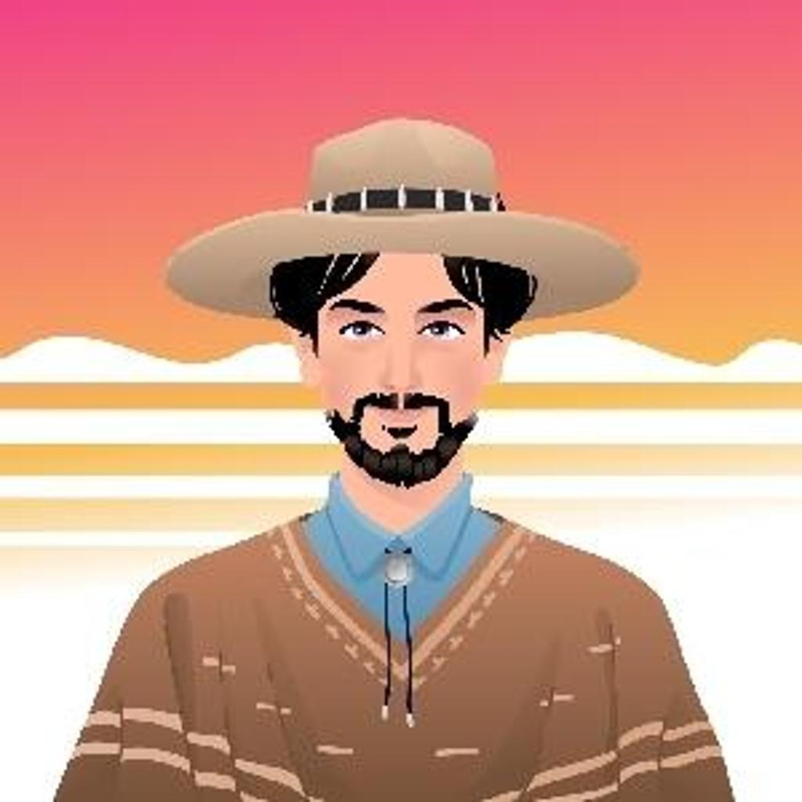

#  Студент Нетологии

Христианин

Родился на территории современной России ,в бывшем СССР

Учился в России в техникуме, во время учёбы переименовали в колледж.Оставалось написать диплом,практику прошёл.

Окончил курс и практику  по специальности сварщик от Центра занятости

Работал сварщиком.

Первый ноутбук появился в 2008 году. 
По  книге освоил базовую работу на ноутбуке.

Научился устанавливать разные операционные системы Линукс ,виртуальные машины и операционные системы Wimdows

В 2026 году  применил технологии ИИ.

ИИ создал для меня на языке Python программу для изучения английского языка.

ИИ в нетологии определил курс для начинающего программиста.

Теперь я студент в Нетологии и изучаю программирование.

